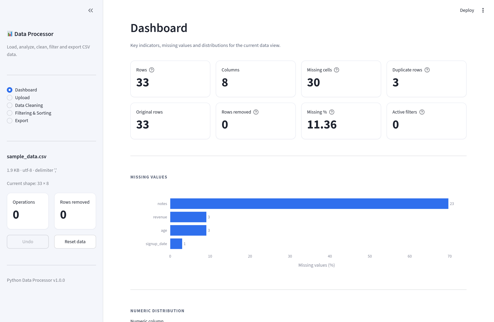
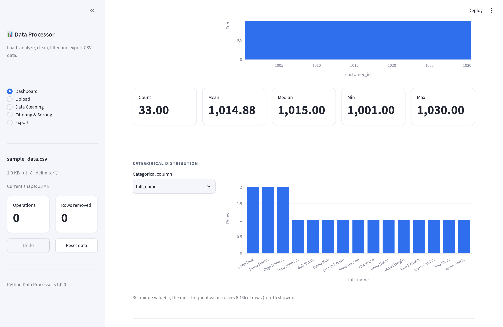
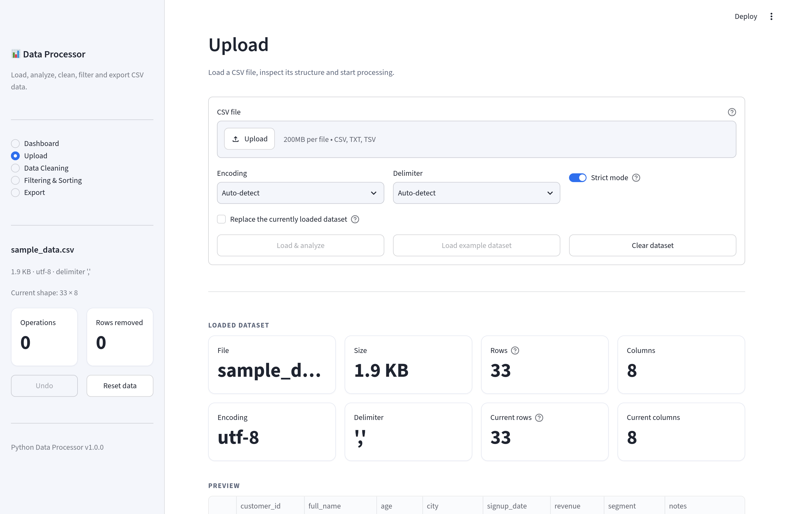
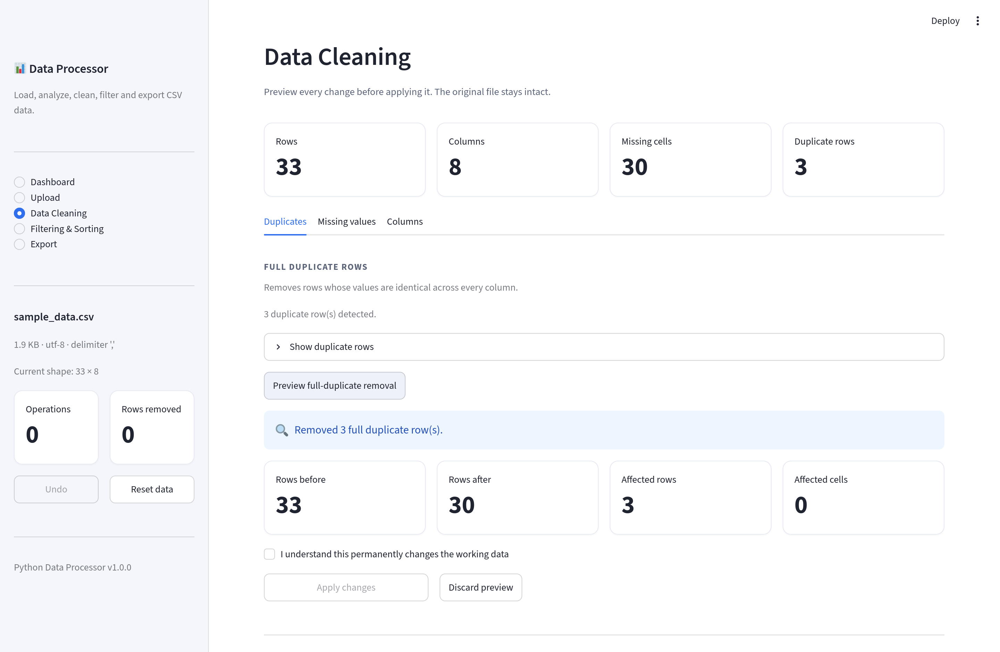
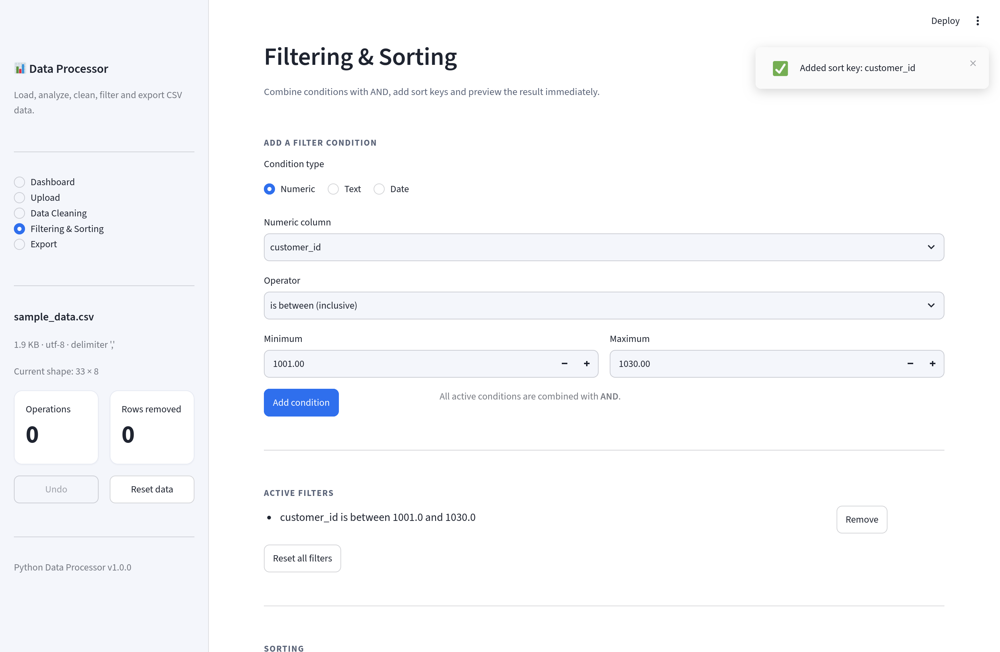
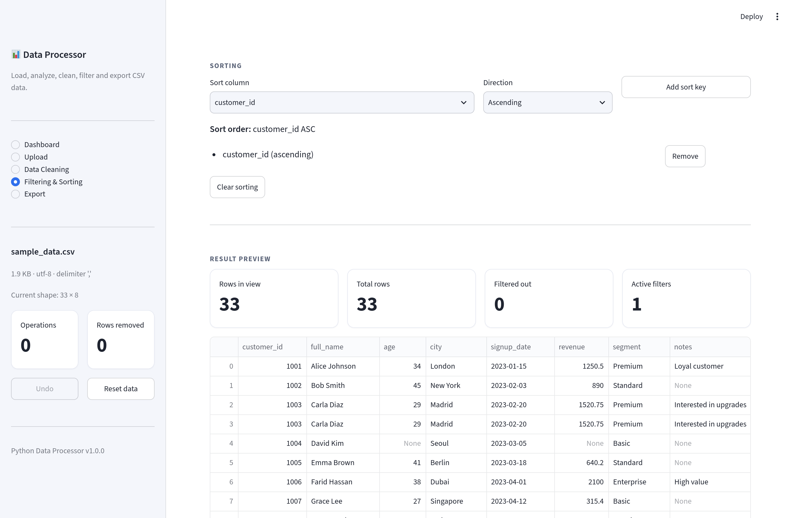
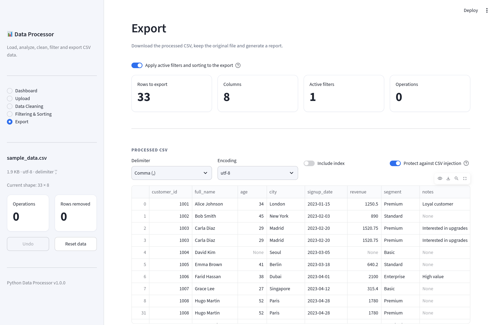
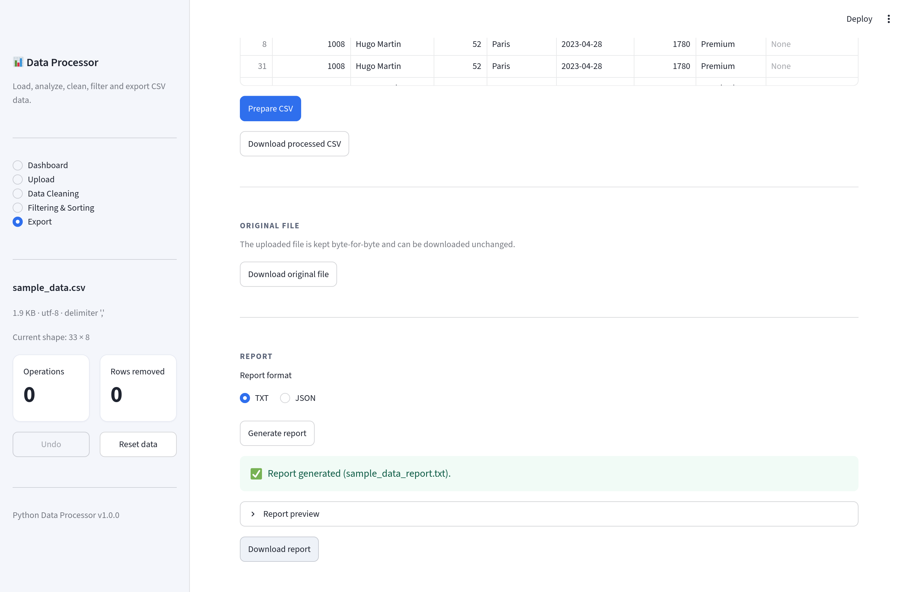

# Python Data Processor

A local, interactive web application for loading, analyzing, cleaning, filtering
and exporting CSV data. Built with **Streamlit**, **pandas**, **NumPy** and
**Plotly**, with a test suite written in **pytest**.

Python Data Processor is a portfolio-grade project: business logic lives in a
reusable Python package with type hints and docstrings, the UI is a thin layer on
top of it, and both are covered by automated tests.

---

## Table of contents

- [Features](#features)
- [Screenshots](#screenshots)
- [Technologies](#technologies)
- [Project structure](#project-structure)
- [Requirements](#requirements)
- [Installation](#installation)
- [Running the application](#running-the-application)
- [User guide](#user-guide)
- [Running the tests](#running-the-tests)
- [Usage examples](#usage-examples)
- [Security notes](#security-notes)
- [Limitations](#limitations)
- [License](#license)

---

## Features

**Upload**
- CSV upload through the browser (`.csv`, `.txt`, `.tsv`).
- Automatic detection of encoding (`utf-8`, `utf-8-sig`, `cp1251`, `cp1252`,
  `iso-8859-1`) and delimiter (`,` `;` `\t` `|`).
- Manual override of both encoding and delimiter.
- Configurable maximum file size.
- Strict or lenient parsing of malformed rows.
- Robust, non-crashing error handling for empty, binary or broken files.

**Analysis**
- Row and column counts, duplicate count, missing-value count and percentage.
- Per-column profile: data type, non-null count, missing percentage, unique values.
- Descriptive statistics for every numeric column.

**Cleaning**
- Remove full duplicate rows or duplicates based on selected columns.
- Drop rows that contain missing values (all columns or a subset).
- Fill missing values with a constant.
- Fill numeric gaps with the mean or median.
- Fill categorical gaps with the most frequent value.
- Drop columns above a configurable missing-value threshold.
- Every operation is *previewed* before it is applied and never mutates the
  original data.

**Filtering & Sorting**
- Numeric range and comparison filters.
- Text filters (contains, equals, starts/ends with, empty checks, case sensitivity).
- Date filters (before, after, on, between).
- Multiple conditions combined with logical **AND**.
- Multi-column ascending/descending sorting.
- One-click reset for filters and sorting.

**Visualization (Dashboard)**
- KPI cards for rows, columns, missing cells and duplicates.
- Missing-value bar chart.
- Numeric distribution histograms.
- Categorical value bar charts.
- Column profile table.

**Export & Reporting**
- Export the processed data to CSV with a selectable delimiter, encoding and index.
- Protection against CSV Formula Injection (`=`, `+`, `-`, `@`).
- Download the original, untouched file.
- Generate a TXT or JSON report describing every operation that was actually
  performed, the applied filters, final statistics and any warnings/errors.

---

## Screenshots

All screenshots below were captured from the running application using the
bundled example dataset (`examples/sample_data.csv`).

### Dashboard





### Upload



### Data Cleaning



### Filtering & Sorting





### Export & Report





---

## Technologies

| Layer | Technology |
| --- | --- |
| Language | Python 3.11+ |
| Web UI | Streamlit |
| Data processing | pandas, NumPy |
| Visualization | Plotly |
| Testing | pytest, pytest-cov |
| Linting & formatting | Ruff |
| Static typing | mypy |

No other runtime dependencies are required.

---

## Project structure

```
Python_Data_Processor/
├── app.py                      # Streamlit entry point (streamlit run app.py)
├── pyproject.toml              # Packaging, Ruff, mypy and pytest configuration
├── requirements.txt            # Runtime dependencies
├── requirements-dev.txt        # Development dependencies
├── README.md
├── LICENSE
├── .gitignore
├── .streamlit/
│   └── config.toml             # Streamlit theme and upload limit
├── docs/
│   └── screenshots/            # Application screenshots used in this README
├── examples/
│   └── sample_data.csv         # Bundled example dataset
├── src/
│   └── data_processor/         # Business logic (no Streamlit imports)
│       ├── __init__.py
│       ├── config.py           # Settings and supported encodings/delimiters
│       ├── exceptions.py       # Custom exception hierarchy
│       ├── models.py           # Dataclasses shared across layers
│       ├── loader.py           # CSV loading and detection
│       ├── analyzer.py         # Data analysis and profiling
│       ├── cleaner.py          # Cleaning operations
│       ├── filters.py          # Filtering and sorting
│       ├── exporter.py         # CSV export and formula protection
│       └── reporter.py         # TXT/JSON report generation
├── ui/                         # Streamlit interface
│   ├── __init__.py
│   ├── state.py                # Session-state management and undo stack
│   ├── styles.py               # Application theme
│   ├── components.py           # Reusable widgets
│   ├── dashboard.py            # Dashboard page
│   ├── upload.py               # Upload page
│   ├── cleaning.py             # Data Cleaning page
│   ├── filtering.py            # Filtering & Sorting page
│   └── export.py               # Export & Report page
└── tests/
    ├── conftest.py             # Shared pytest fixtures
    ├── test_config.py
    ├── test_loader.py
    ├── test_analyzer.py
    ├── test_cleaner.py
    ├── test_filters.py
    ├── test_exporter.py
    ├── test_reporter.py
    └── test_app.py             # End-to-end UI smoke tests
```

The `src/data_processor` package is deliberately independent from Streamlit so
that the logic can be reused from scripts, notebooks and tests.

---

## Requirements

- Python **3.11** or newer (developed and tested on 3.14).
- The packages listed in `requirements.txt`.
- No database, network connection or external service is required.

---

## Installation

### Linux / macOS

```bash
git clone https://github.com/makar-ne-robot/Python-Data-Processor
cd Python_Data_Processor

python3 -m venv .venv
source .venv/bin/activate

pip install --upgrade pip
pip install -r requirements.txt
```

For development (tests, linting and type checking):

```bash
pip install -r requirements-dev.txt
```

### Windows (PowerShell)

```powershell
git clone https://github.com/makar-ne-robot/Python-Data-Processor
cd Python_Data_Processor

py -m venv .venv
.\.venv\Scripts\Activate.ps1

python -m pip install --upgrade pip
pip install -r requirements.txt
```

If PowerShell blocks the activation script, run:

```powershell
Set-ExecutionPolicy -Scope CurrentUser -ExecutionPolicy RemoteSigned
```

### Windows (Command Prompt)

```bat
py -m venv .venv
.venv\Scripts\activate.bat
python -m pip install --upgrade pip
pip install -r requirements.txt
```

> The application itself is platform independent.

---

## Running the application

From the project root, with the virtual environment activated:

```bash
streamlit run app.py
```

Streamlit prints a local URL (by default <http://localhost:8501>). Open it in
your browser. To use a different port:

```bash
streamlit run app.py --server.port 8502
```

The maximum upload size can be configured either in `.streamlit/config.toml`
(`server.maxUploadSize`) or with the environment variable
`DATA_PROCESSOR_MAX_FILE_MB` (for example `DATA_PROCESSOR_MAX_FILE_MB=100`).

---

## User guide

### 1. Upload

1. Open the **Upload** page.
2. Choose a CSV file (or click **Load example dataset**).
3. Optionally select a specific encoding or delimiter, or toggle **Strict mode**
   off to skip malformed rows.
4. Click **Load & analyze**.

The page shows the file size, row/column counts, detected encoding and delimiter,
a preview, and a per-column summary.

### 2. Dashboard

Displays KPIs, a missing-value chart, a numeric histogram and a categorical bar
chart. Use the selectors to switch the analyzed column. Charts automatically
reflect the active filters.

### 3. Data Cleaning

Organized into three tabs:

- **Duplicates** — remove full duplicates or duplicates by selected columns.
- **Missing values** — drop rows with missing values, fill with a constant, fill
  numeric gaps (mean/median) or categorical gaps (mode).
- **Columns** — review missing values per column and drop columns above a
  threshold.

Every action first shows a **preview** (rows/cells affected) and requires an
explicit confirmation for destructive operations before it is applied. The
original data is never modified; use **Undo** in the sidebar to revert the last
operation or **Reset data** to start over.

### 4. Filtering & Sorting

- Add numeric, text or date conditions. Conditions are combined with AND.
- Add one or more sort keys (ascending or descending).
- The result preview updates immediately, together with row counters.
- Use **Reset all filters** or **Clear sorting** to remove them.

### 5. Export

- Choose delimiter, encoding and whether to include the index.
- Toggle **Protect against CSV injection** to neutralise dangerous cells.
- Click **Prepare CSV** and download the processed file.
- Download the original file unchanged.
- Generate and download a **TXT** or **JSON** processing report.

---

## Running the tests

```bash
# Run the full suite
pytest

# With coverage
pytest --cov --cov-report=term-missing

# Linting and formatting
ruff check .
ruff format --check .

# Static type checking (core business logic)
mypy
```

The suite covers CSV loading (encodings, delimiters, malformed input),
analysis, every cleaning operation, filtering, sorting, CSV export, report
generation, edge cases (empty frames, single-column frames, mixed dtypes) and
end-to-end UI rendering via Streamlit's `AppTest` runner.

The core package currently has ~92% branch coverage. UI smoke tests verify that
all pages render and that preview → apply, undo, filtering and export work.

---

## Usage examples

Although the project is a web application, the business logic can be used
directly from Python:

```python
from data_processor import (
    analyze_dataframe,
    apply_filters,
    build_report,
    drop_full_duplicates,
    export_csv,
    fill_numeric_missing,
    load_csv_path,
    FilterCondition,
)

# 1. Load a file
loaded = load_csv_path("examples/sample_data.csv")
frame = loaded.dataframe

# 2. Analyze it
analysis = analyze_dataframe(frame)
print(analysis.rows, analysis.columns, analysis.duplicate_rows, analysis.total_missing)

# 3. Clean it (operations return new frames; the input is never modified)
cleaned = drop_full_duplicates(frame).dataframe
cleaned = fill_numeric_missing(cleaned, "mean").dataframe

# 4. Filter it
result = apply_filters(cleaned, [FilterCondition("age", "between", 25, 45)])

# 5. Export it with formula-injection protection
payload = export_csv(result, delimiter=";", encoding="utf-8", protect_formulas=True)
with open("result.csv", "wb") as file:
    file.write(payload)

# 6. Build a report
report = build_report(
    source=loaded.metadata,
    original_shape=frame.shape,
    final_dataframe=result,
    operations=[],
    filters=[FilterCondition("age", "between", 25, 45)],
)
print(report.to_text())
```

---

## Security notes

- `eval()` and `exec()` are never used.
- Uploaded files are processed **in memory** and are never written to disk.
- CSV content is never executed, and the contents of uploaded files are never
  logged.
- All user input is validated; errors are converted into friendly messages by
  the application's exception hierarchy.
- The exporter provides protection against **CSV Formula Injection**: string
  cells beginning with `=`, `+`, `-` or `@` are prefixed with an apostrophe so
  spreadsheets treat them as text.
- The original data is immutable from the UI's point of view, preventing
  accidental destruction of the source data.
- No secrets are stored in the source code.

---

## Limitations

- One dataset is processed at a time; there is no database or persistence beyond
  the current browser session.
- Uploaded data is kept in memory, so very large files are limited by the
  configured size and available RAM. The default limit is 50 MB.
- Only delimited text/CSV input is supported (no Excel or JSON input).
- Date detection and date filtering use a heuristic and may require the user to
  select the column manually for ambiguous formats.
- Formula protection changes exported string values by adding a leading
  apostrophe. Disable it when exporting for non-spreadsheet consumers.
- The application has no authentication and is intended to run locally.
- `mypy` type checking is applied to the core business-logic package; the
  Streamlit pages are covered by linting and UI tests instead.

---

## License

This project is released under the **MIT License**. See [LICENSE](LICENSE) for
details.
